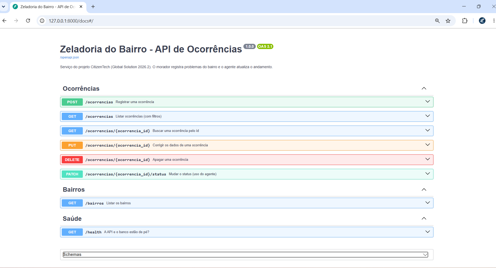
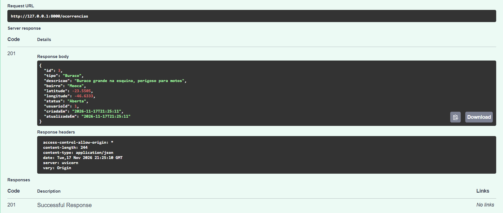
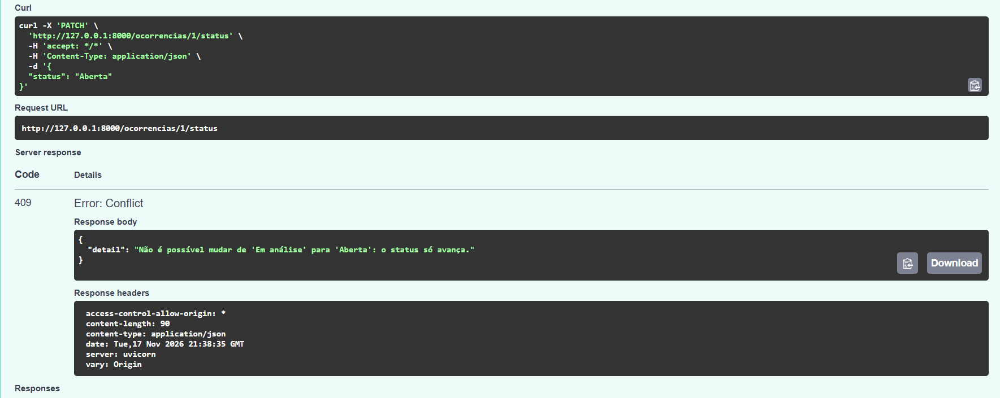
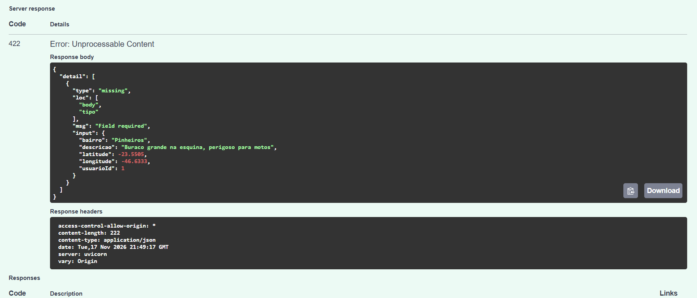
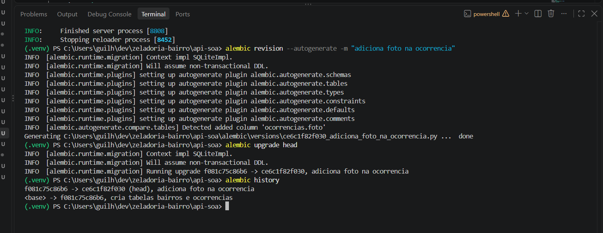
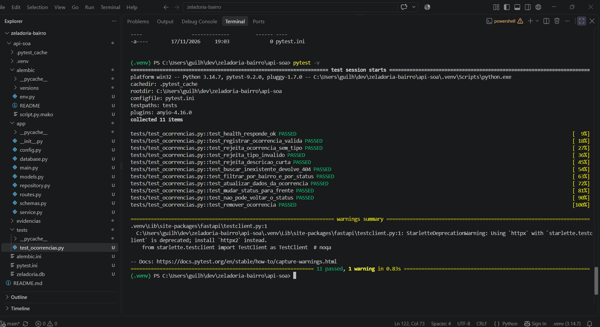

# Zeladoria do Bairro - API de Ocorrências (SOA e Web Services)

Projeto da Global Solution CitizenTech 2026.2 (FIAP, Engenharia de Software).

## Ficha da CitizenTech

| Item | Descrição |
| --- | --- |
| Nome | Zeladoria do Bairro |
| Cidade | São Paulo |
| Cidadão beneficiado | Morador que convive com o problema (e o agente que atende as ocorrências) |
| Problema, em uma frase | O morador não tem um jeito simples de registrar problemas do espaço público do bairro e não sabe se o chamado foi atendido. |
| Como funciona | Registrar, acompanhar e atualizar ocorrências, com alerta automático de poste apagado (IoT). |
| O que cada parte faz | App mobile: o morador registra e acompanha. Esta API (SOA): guarda as ocorrências e aplica as regras de status. Serviço de usuários (C#): perfis e histórico. Sensor IoT: poste apagado abre ocorrência. ML: estima o tempo de resolução. Infraestrutura Linux (OS): hospeda e monitora a API. |
| Link do repositório | https://github.com/guiaugustou/zeladoria-bairro |
| Indicador de impacto | Tempo médio de resolução das ocorrências e % de ocorrências resolvidas. |
| ODS conectados | ODS 11 (cidades e comunidades sustentáveis): melhora o espaço público e a participação do morador. ODS 9 (indústria, inovação e infraestrutura): usa tecnologia para manter a infraestrutura urbana. |
| Dados | Dados simulados; nenhum dado pessoal real. |

## Integrantes

Augusto Rocha Silva - RM556316
Erik Yuuta Goto - RM558076
Guilherme Vieira Augusto - RM557264
Wendell dos Santos Silva - RM558859

## O que esta API faz

Serviço de ocorrências da CitizenTech. O morador registra um problema do bairro (buraco, lixo ou iluminação) e o agente acompanha até a resolução. A ocorrência passa por Aberta, Em análise, Em andamento e Resolvida, e o status só avança.

## Tecnologias

Python, FastAPI, SQLAlchemy, Alembic e pytest. Banco: SQLite por padrão; para trocar (por exemplo, PostgreSQL), use a variável `DATABASE_URL`.

## Como rodar

Todos os comandos são executados dentro da pasta `api-soa`.

1. Crie e ative o ambiente virtual: `python -m venv .venv` e depois `.venv\Scripts\Activate.ps1` (Windows) ou `source .venv/bin/activate` (Linux e Mac)
2. Instale as dependências: `pip install -r requirements.txt`
3. Crie as tabelas: `alembic upgrade head`
4. Ligue a API: `uvicorn app.main:app --reload`
5. Abra a documentação (Swagger): http://127.0.0.1:8000/docs

## Variáveis de ambiente

- `DATABASE_URL`: endereço do banco. Padrão: `sqlite:///./zeladoria.db`

## Endpoints

| Método | Caminho | O que faz |
| --- | --- | --- |
| POST | /ocorrencias | Registra uma ocorrência (201) |
| GET | /ocorrencias | Lista as ocorrências, com filtros opcionais `status` e `bairro` |
| GET | /ocorrencias/{id} | Busca uma ocorrência (404 se não existir) |
| PUT | /ocorrencias/{id} | Corrige os dados da ocorrência (não mexe no status) |
| PATCH | /ocorrencias/{id}/status | Muda o status; só avança (409 se tentar voltar) |
| DELETE | /ocorrencias/{id} | Apaga a ocorrência (204) |
| GET | /bairros | Lista os bairros que têm ocorrência |
| GET | /health | Confere a API e o banco (503 se o banco estiver fora) |

## Regras de negócio

- `tipo` deve ser Buraco, Lixo ou Iluminação
- descrição de 5 a 500 caracteres, bairro de 2 a 100, latitude de -90 a 90 e longitude de -180 a 180
- `foto` é opcional (endereço da imagem, até 300 caracteres)
- toda ocorrência nasce Aberta e o status só avança (voltar devolve erro 409)

## Estrutura do projeto

```
app/
  main.py        liga tudo: rotas, CORS, tratamento de erros e /health
  routes.py      os endpoints (recebem os pedidos HTTP)
  service.py     as regras de negócio
  repository.py  o acesso ao banco
  models.py      as tabelas (SQLAlchemy)
  schemas.py     o formato dos dados e as validações (Pydantic)
  database.py    a conexão com o banco
  config.py      as configurações (DATABASE_URL)
alembic/versions/  as migrações
tests/             os testes automáticos
evidencias/        os prints
```

## Testes

Rode `pytest -v`. São 11 testes automáticos, com banco em memória (o banco real não é alterado).

## Migrações

Pasta `alembic/versions`:

1. `f081c75c86b6`: cria as tabelas `bairros` e `ocorrencias`
2. `ce6c1f82f030`: adiciona a coluna `foto`

## Evidências

Documentação automática (Swagger):



Registro de ocorrência (201):



Regra de negócio, o status não volta (409):



Validação, ocorrência sem tipo (422):



Migrações:



Testes automáticos:



## Uso de IA

Registrado em [prompts.md](../prompts.md).