# Infra e Sistemas Operacionais (OS) - Zeladoria do Bairro

Projeto da Global Solution CitizenTech 2026.2 (FIAP, Engenharia de Software).

## Ficha da CitizenTech

| Item | Descrição |
| --- | --- |
| Nome | Zeladoria do Bairro |
| Cidade | São Paulo |
| Cidadão beneficiado | Morador que convive com o problema (e o agente que atende as ocorrências) |
| Problema, em uma frase | O morador não tem um jeito simples de registrar problemas do espaço público do bairro e não sabe se o chamado foi atendido. |
| Como funciona | Registrar, acompanhar e atualizar ocorrências, com alerta automático de poste apagado (IoT). |
| O que cada parte faz | App mobile: o morador registra e acompanha. Esta API (SOA): guarda as ocorrências e aplica as regras de status. Serviço de usuários (C#): perfis e histórico. Sensor IoT: poste apagado abre ocorrência. ML: estima o tempo de resolução. Infraestrutura Linux (OS): hospeda e monitora a API. |
| Link do repositório | https://github.com/guiaugustou/zeladoria-bairro |
| Indicador de impacto | Tempo médio de resolução das ocorrências e % de ocorrências resolvidas. |
| ODS conectados | ODS 11 (cidades e comunidades sustentáveis): melhora o espaço público e a participação do morador. ODS 9 (indústria, inovação e infraestrutura): usa tecnologia para manter a infraestrutura urbana. |
| Dados | Dados simulados; nenhum dado pessoal real. |

## Integrantes

Augusto Rocha Silva - RM556316
Erik Yuuta Goto - RM558076
Guilherme Vieira Augusto - RM557264
Wendell dos Santos Silva - RM558859

## Visão geral

Esta pasta entrega a parte de **Sistemas Operacionais (OS)** do projeto Zeladoria do Bairro. A API de ocorrências (pasta `api-soa`) é instalada, configurada e mantida no ar em um Linux por **scripts Bash reproduzíveis**, com serviços **systemd**, **monitoramento**, **logs de execução e auditoria** e **testes de falha**.

Tudo foi executado em **WSL2 com Ubuntu 26.04 LTS** (Windows 11, systemd ativo). Os scripts também servem para uma VM Ubuntu/Debian com systemd.

**Vídeo de demonstração (até 7 min):** LINK-DO-VIDEO

## Estrutura

```
infra-os/
├── scripts/            lib.sh, 01-infra.sh, 02-app.sh, 03-monitor.sh, monitor.sh
├── systemd/            zeladoria-api.service, zeladoria-monitor.service
├── testes-de-falha/    01-parar-api.sh, 02-carga.sh, 03-erro-controlado.sh, 04-pos-reboot.sh
├── logs/               cópias dos logs gerados durante os testes
└── evidencias/         prints da execução
```

## Como reproduzir

Pré-requisito: Windows 11 com WSL2 e Ubuntu com systemd (`wsl --install -d Ubuntu`), ou uma VM Ubuntu/Debian com systemd.

```bash
git clone https://github.com/guiaugustou/zeladoria-bairro.git
cd zeladoria-bairro
sudo bash infra-os/scripts/01-infra.sh
sudo bash infra-os/scripts/02-app.sh
sudo bash infra-os/scripts/03-monitor.sh
```

Para conferir: `curl http://localhost:8000/health` deve responder `{"status":"ok","banco":"ok"}`, e o Swagger fica em `http://localhost:8000/docs` (no WSL, abre também no navegador do Windows).

No WSL, as mudanças de hostname e DNS feitas pelo `01-infra.sh` ficam em `/etc/wsl.conf` e passam a valer depois de `wsl --shutdown` (no PowerShell do Windows) e de abrir o Ubuntu de novo.

Todos os scripts podem ser executados mais de uma vez sem estragar nada (são idempotentes).

## Scripts

| Script | O que faz |
|---|---|
| `scripts/01-infra.sh` | **Infraestrutura:** define o hostname (`zeladoria-srv`); mostra e testa IP, rota padrão e conectividade; configura o DNS com servidores de reserva; cria usuários, grupos e diretórios com permissões. |
| `scripts/02-app.sh` | **Aplicação:** instala as dependências (python3, venv, curl); copia a API para `/opt/zeladoria/app`; cria o arquivo de variáveis de ambiente; monta o venv com o `requirements.txt`; roda as migrações do banco; instala e inicia o serviço `zeladoria-api` com início automático. |
| `scripts/03-monitor.sh` | **Instala o monitoramento:** copia o monitor para `/opt/zeladoria/bin`, cria o arquivo de limites, configura a rotação dos logs e liga o serviço `zeladoria-monitor`. |
| `scripts/monitor.sh` | **Monitoramento:** mede CPU, memória, disco e consulta o `/health` da API; grava alertas e reinicia a API se ela parar de responder. |
| `scripts/lib.sh` | Funções comuns: log, auditoria e tratamento de erro. |

Tratamento de erro: todos usam `set -Eeuo pipefail`. Uma armadilha (`trap`) registra a linha, o comando e o código de qualquer falha, e outra registra como o script terminou.

## Serviços systemd

| Serviço | Usuário | Comportamento |
|---|---|---|
| `zeladoria-api` | `zeladoria` (sem login) | Roda o uvicorn na porta 8000. Lê `DATABASE_URL` do arquivo de ambiente. `Restart=on-failure` com 3 s de espera. Liga junto com o sistema (`WantedBy=multi-user.target`). |
| `zeladoria-monitor` | `root` (precisa reiniciar a API) | Roda o `monitor.sh` em loop. `Restart=on-failure` com 5 s de espera. Liga junto com o sistema. Aceita `start`, `stop` e `restart`; no `stop` o script encerra de forma limpa e registra no log. |

Comandos úteis:

```bash
systemctl status zeladoria-api --no-pager
sudo systemctl stop|start|restart zeladoria-monitor
journalctl -u zeladoria-api -n 20 --no-pager
```

## Permissões e segredos

| Caminho | Dono:grupo | Modo | Para quê |
|---|---|---|---|
| `/opt/zeladoria` | root:zeladoria | 750 | código da API e ambiente Python |
| `/opt/zeladoria/bin` | root:root | 755 | programas do monitor |
| `/etc/zeladoria` | root:zeladoria | 750 | configuração |
| `/etc/zeladoria/zeladoria.env` | root:zeladoria | 640 | `DATABASE_URL`: fica fora do código e do GitHub |
| `/etc/zeladoria/monitor.env` | root:root | 644 | limites do monitor |
| `/var/lib/zeladoria` | zeladoria:zeladoria | 750 | banco SQLite |
| `/var/log/zeladoria` | root:zeladoria-ops | 2775 | logs; o grupo `zeladoria-ops` (operadores) pode ler e gravar |

O serviço roda com um usuário próprio (`zeladoria`), sem login e sem privilégios, e só enxerga o que precisa.

## Logs

| Log | Conteúdo |
|---|---|
| `/var/log/zeladoria/execucao.log` | O que cada script fez, passo a passo (`INFO`, `WARN`, `ERROR`). |
| `/var/log/zeladoria/auditoria.log` | Quem executou o quê: usuário, script, início e fim com código de saída. Também registra ações automáticas, como o reinício da API pelo monitor, e os testes de falha. |
| `/var/log/zeladoria/monitor.log` | Uma linha por verificação e as linhas de alerta. |
| `journalctl -u zeladoria-api` / `-u zeladoria-monitor` | Saída dos serviços no journal do systemd. |

Os logs são rotacionados toda semana (4 cópias, compactadas) pelo `logrotate`. Cópias geradas durante os testes estão em `infra-os/logs/`.

## Monitoramento

Verifica a cada 10 segundos. Os limites ficam em `/etc/zeladoria/monitor.env`.

| Item | Limite padrão |
|---|---|
| CPU | 80% |
| Memória | 80% |
| Disco (`/`) | 85% |
| API (`/health`) | 2 falhas seguidas reiniciam o serviço |

Exemplos reais do `monitor.log`:

```
2026-11-17 23:22:27 [ALERT] API sem resposta em http://127.0.0.1:8000/health (falha 1 de 2)
2026-11-17 23:22:38 [ALERT] reiniciando zeladoria-api.service (estado antes: inactive)
2026-11-17 23:22:39 [INFO] API recuperada em 1s após o reinício
2026-11-17 23:24:30 [ALERT] CPU em 99% (limite 80%)
```

## Testes de falha

| # | Script | O que provoca | Resultado observado | Evidência |
|---|---|---|---|---|
| 1 | `01-parar-api.sh` | A) `kill -9` na API. B) `systemctl stop` na API. | A) o systemd religou em ~4 s (PID 6983 → 26373). B) o monitor viu 2 falhas, reiniciou a API e ela voltou em 24 s. | `07` |
| 2 | `02-carga.sh` | 20 núcleos a 100% por 25 s; depois ~1910 MB de RAM ocupados. | `ALERT` de CPU em 99%; `ALERT` de memória em 19% (limite de demonstração de 12%). | `08` |
| 3 | `03-erro-controlado.sh` | Um comando que falha de propósito. | O log registra a linha, o comando e o código 1; a auditoria registra `FIM codigo=1`. | `09` |
| 4 | `wsl --shutdown` + `04-pos-reboot.sh` | Desligar o Linux e ligar de novo. | API e monitor `active` 3 s depois do boot, sem intervenção; o hostname `zeladoria-srv` persistiu. | `10` |

## Evidências

**Script de infraestrutura (`01-infra.sh`)**
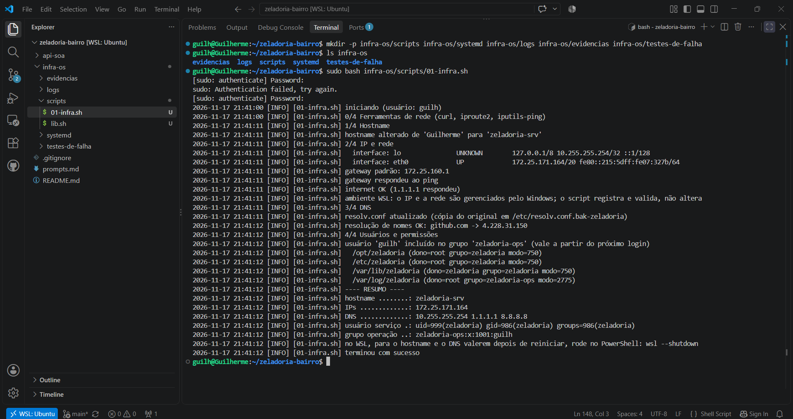

**Logs de auditoria e de execução**
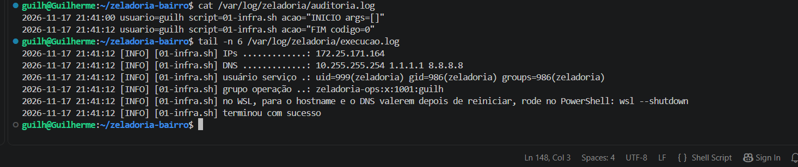

**Script de aplicação (`02-app.sh`)**
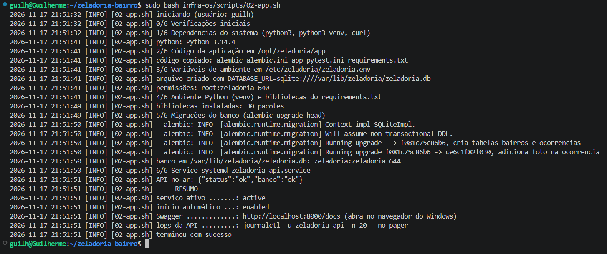

**Serviço da API ativo, habilitado e respondendo ao `/health`**
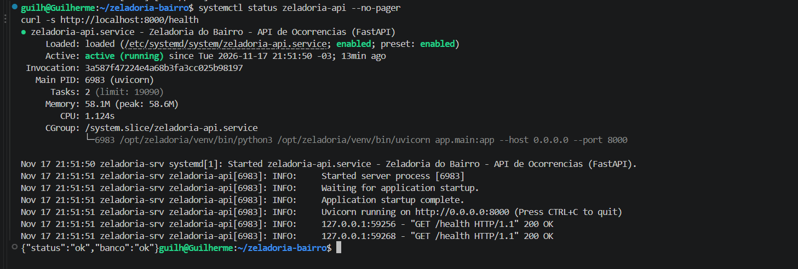

**Swagger da API acessado do Windows, rodando no Linux**
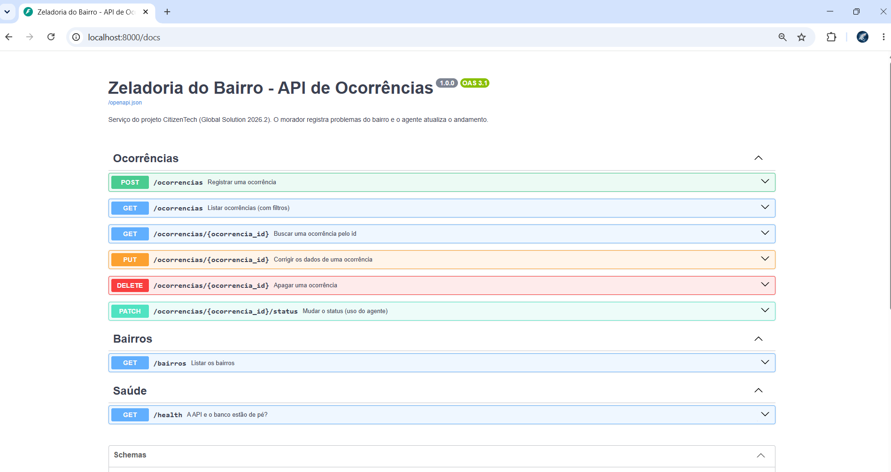

**Serviço de monitoramento e `monitor.log`**
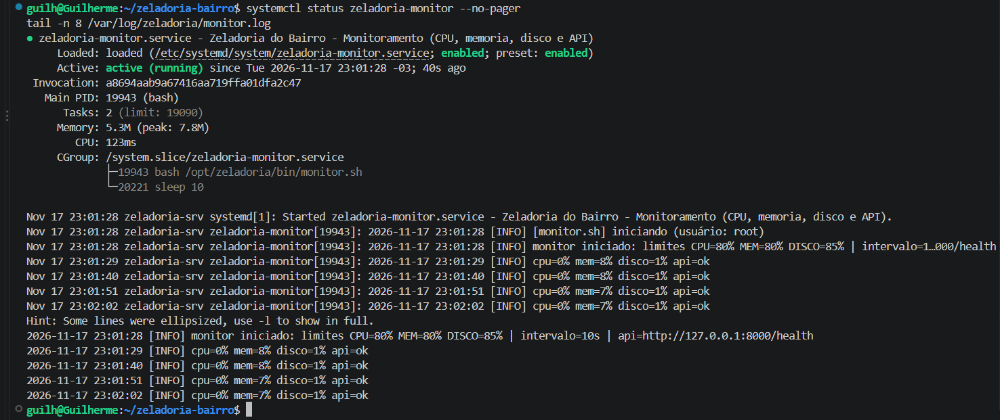

**Start, stop e restart do monitor**
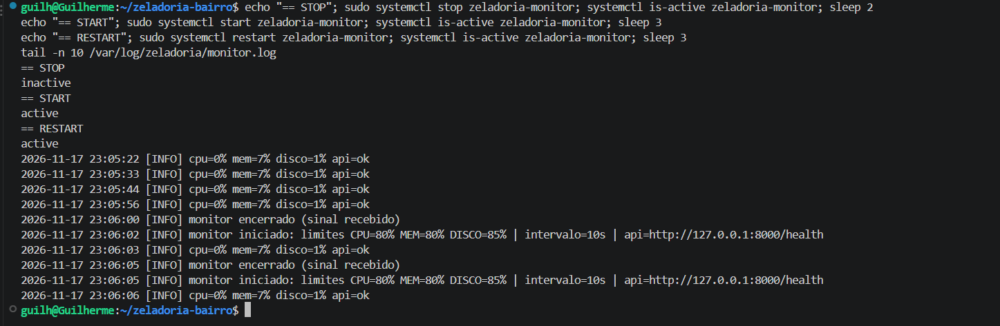

**Teste: parar a API e ver a recuperação**
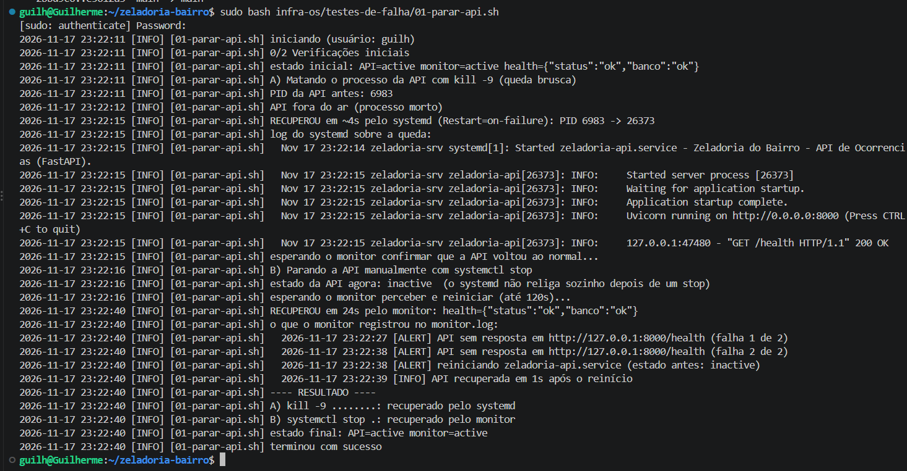

**Teste: sobrecarga de CPU e memória**
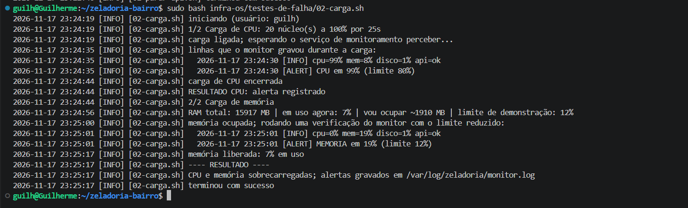

**Teste: erro controlado registrado no log**
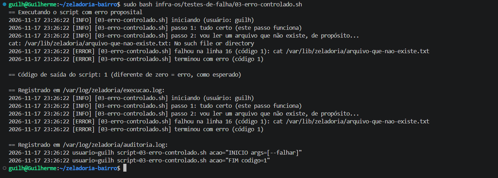

**Teste: reinício do Linux, serviços sobem sozinhos**
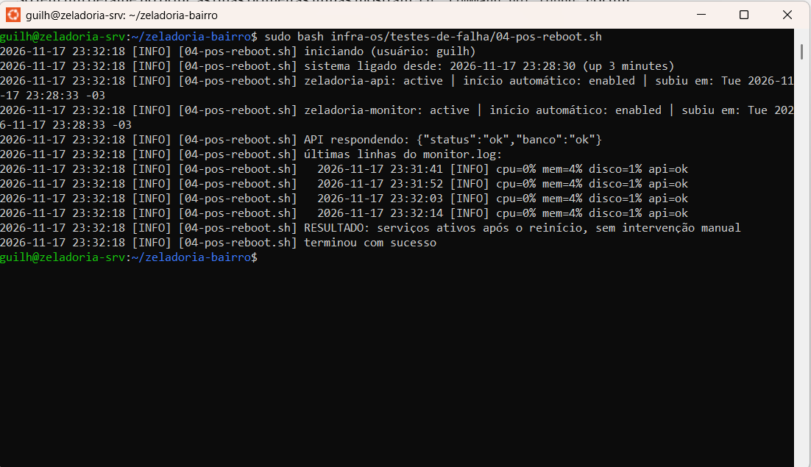

## Decisões e limitações

- **Rede no WSL:** o Windows gerencia o IP e o gateway da máquina virtual, então o script mostra e valida a rede em vez de configurá-la. Hostname e DNS são configurados e ficam gravados em `/etc/wsl.conf`.
- **VM:** o script também tem o ramo para uma VM (DNS via `systemd-resolved`), mas só foi testado no WSL.
- **Monitor como `root`:** ele precisa reiniciar a API. Uma alternativa mais restrita seria usar um usuário próprio com permissão pontual via `sudoers`.
- **Parada manual:** como o monitor reinicia a API depois de um `systemctl stop`, uma parada de manutenção deve começar parando o monitor (`sudo systemctl stop zeladoria-monitor`).
- **Teste de memória:** o limite padrão de 80% exigiria ocupar quase toda a RAM da máquina, então só nessa demonstração o limite é reduzido (aparece na saída do teste).
- **Banco:** SQLite em arquivo, em `/var/lib/zeladoria/zeladoria.db`.

## Critérios da rubrica e onde estão

| Critério | Onde está | Evidência |
|---|---|---|
| Script de infraestrutura (hostname, IP/rede, DNS, usuários e permissões) | `scripts/01-infra.sh` | `01`, `02` |
| Script de aplicação (dependências, diretórios, variáveis de ambiente, permissões, serviço com início automático) | `scripts/02-app.sh`, `systemd/zeladoria-api.service` | `03`, `04` |
| Script de monitoramento (CPU, memória, disco, alertas) | `scripts/monitor.sh` | `05`, `08` |
| Monitoramento como serviço systemd | `systemd/zeladoria-monitor.service`, `scripts/03-monitor.sh` | `05`, `06` |
| Logs de auditoria e de execução | `scripts/lib.sh`, `logs/` | `02`, `09` |
| Operação completa (testes de falha) | `testes-de-falha/` | `07` a `10` |